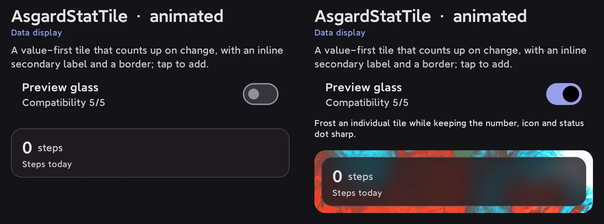
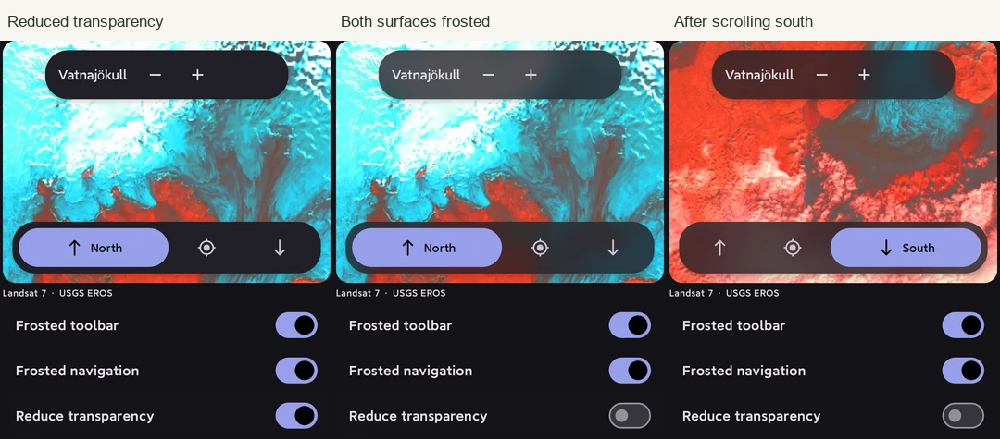

# Opt-in frosted glass

Add `implementation("com.trinadhthatakula:asgard-glass:2.2.0")` from Maven Central to an Android module or a Kotlin Multiplatform `commonMain.dependencies` block. Within the Asgard checkout, use `implementation(project(":asgard-glass"))`. The add-on supplies matching Asgard core and uses Haze 2.1.0 internally. Apps using core alone keep their existing dependency.

## Register a backdrop

Register the content beneath the controls once per screen. Place overlapping controls beside that source in the same layout. Give the first and last scroll items enough content padding to clear the overlays.

```kotlin
import com.valhalla.asgard.glass.asgardGlassSource
import com.valhalla.asgard.glass.rememberAsgardGlassSource

val source = rememberAsgardGlassSource(
    enabled = !reduceTransparency && (glassToolbar || glassNavigation),
)
Box(Modifier.fillMaxSize()) {
    LazyColumn(
        modifier = Modifier.fillMaxSize().asgardGlassSource(source),
        contentPadding = PaddingValues(top = 80.dp, bottom = 96.dp),
    ) {
        items(rows) { row -> RowContent(row) }
    }
    AsgardActionToolbar(
        actions = actions,
        container = source.frosted(glassToolbar),
        modifier = Modifier.align(Alignment.TopCenter).padding(12.dp),
    )
    AsgardNavigationBar(
        items = tabs,
        selectedIndex = selected,
        onSelect = onSelect,
        configuration = AsgardNavigationConfiguration(placement = AsgardNavigationPlacement.Floating),
        container = source.frosted(glassNavigation),
        modifier = Modifier.align(Alignment.BottomCenter),
    )
}
```

Omit `container` for the regular Material appearance. The toolbar and configured navigation overloads apply frost at the inner component bounds.

## Apply glass to any component

Use `com.valhalla.asgard.glass.asgardGlass` on an Asgard, Material or custom composable that takes a modifier. Put outer margins before the effect and inner padding after it. When a control draws an opaque container, select a transparent fill for that instance and preserve its foreground, ripple, disabled colors and semantics.

```kotlin
val shape = MaterialTheme.shapes.large
val fill = MaterialTheme.colorScheme.surfaceContainer
val source = rememberAsgardGlassSource(enabled = glassCard && !reduceTransparency)
Box {
    Photo(Modifier.matchParentSize().asgardGlassSource(source))
    AsgardStatCard(
        label = "Voltage", value = "5.00", unit = "V",
        modifier = Modifier.asgardGlass(source, enabled = glassCard, shape = shape, containerColor = fill),
        shape = shape,
        containerColor = if (glassCard) Color.Transparent else fill,
        onClick = openVoltageDetails,
    )
}
```

Here `Photo` stands for app-owned image content. Setting `glassCard` to false restores the normal card. With `glassCard` on and reduced transparency enabled, the same card gets a solid themed base. A Material `Button` follows the same recipe using `ButtonDefaults.buttonColors(containerColor = …, contentColor = …)`; keep its disabled colors and set glass only while the button is enabled.

For a slot without a modifier, use `AsgardGlassSurface(source, enabled = glassHeader) { HeaderContent() }`. An opaque image can use a frosted caption or surrounding frame. Place both source and effect inside a sheet or dialog window when styling modal content.

## Platform behavior

| Target | Behavior |
| --- | --- |
| Hardware-accelerated Android API 33+ | Samples the registered backdrop for opted-in surfaces. |
| Android API 28–32 or software-rendered Android window | Uses the normal Material surface. API 31–32 stay on this path pending physical-device profiling of source recapture. |
| Browser Wasm | Uses Haze's Skia-backed blur. A live `prefers-reduced-transparency: reduce` preference selects solid surfaces. |

Set `enabled = false` on the shared source for an app-wide reduced-transparency preference. This also removes source capture. A missing or removed source falls back to the base surface. Check your own content colors against the brightest and darkest backgrounds the app displays. This version implements frost on Asgard’s Android and Wasm targets.

## Try the gallery

Choose **Browse → component → Preview glass** in the Android test app or browser gallery. Each entry has its own switch, score and guidance. For a sheet or dialog, turn on the preview and open the modal. Try **AsgardStatTile · animated** to compare the two treatments and tap the tile to change its value.

Scores describe design and integration suitability. A 5/5 card has a natural glass container. A 1/5 shimmer keeps its skeleton animation and uses glass on a surrounding surface. [Full rubric and all component ratings](../.claude/skills/asgard-ui/references/glass.md)

In **Glass surfaces**, scroll the image and select a region. The main preview switch frosts the region label. The toolbar and navigation have their own switches. The gallery uses a Landsat 7 image of Vatnajökull supplied by USGS EROS. [NASA Earth Observatory image](https://science.nasa.gov/earth/earth-observatory/vatnajokull-iceland-3039/)

```sh
adb shell am start -n com.valhalla.asgard.app/.MainActivity --es entry glass-surfaces
```

The Android gallery includes a pixel test for frost, source changes, per-instance selection and the solid fallback. The benchmark app provides `glass-plain`, `glass-toolbar` and `glass-both` workloads over the same scrolling list. [Android gallery and test commands](android-gallery.md)

## Device verification

On the Xiaomi (API 37), the animated stat tile picked up the glacier colors and still counted up when tapped. Navigating to the avatar left its switch off. Returning to the tile restored its glass choice.



The browser gallery also rendered the frosted tile, restored its selection on Back, and returned to a solid fill when Chromium emulated reduced transparency.

The glacier scene on the Xiaomi showed the backdrop updating as the selected region scrolled into view. Enabling reduced transparency restored both Material fills.



On the API 36 emulator, all 38 app tests passed. The gallery test enabled glass on each of the 54 entries. Pixel tests covered a generic Material button, shape clipping, independent selection, source removal and a minimum 4.5:1 default navigation-label contrast over black and white backdrops. All four glass tests passed on the API 28 fallback. An independent consumer compiled against locally published snapshot artifacts on Android and Wasm.

Two six-second runs of the optimized scrolling benchmark on the API 36 emulator gave p95 total frame durations of 19.8–23.2 ms with solid controls, 27.8–27.9 ms with a frosted toolbar, and 19.7–27.3 ms with both controls frosted. The measured cost varied across runs. Optimized physical-device and browser performance still need measurement.
